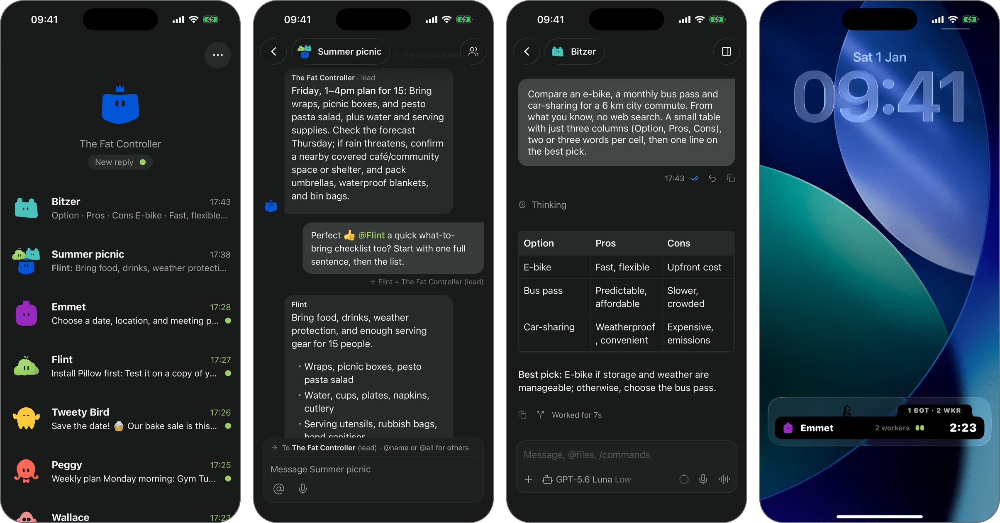

**English** | [Español](README.es.md) | [简体中文](README.zh-CN.md) | [日本語](README.ja.md) | [Français](README.fr.md) | [Deutsch](README.de.md)

<!-- LOGO: placeholder until the brand visuals are chosen. -->
<h1 align="center">🦖 DinoBot</h1>

<p align="center"><b>Your own team of AI bots, in your pocket.</b></p>
<!-- DRAFT tagline: not confirmed yet. -->

<p align="center">DinoBot is built on Paseo: it is a fork of <a href="https://github.com/getpaseo/paseo">Paseo</a> by Mohamed Boudra.
Many thanks to the Paseo project.</p>

<p align="center">
  <a href="LICENSE">Apache-2.0</a> ·
  <a href="docs/how-it-works.md">How it works</a> ·
  <a href="SECURITY.md">Security</a>
</p>

- 📱 **Phone-first.** A real iPhone app: chat with your bots, follow their workers, and (with an
  app you build yourself, see below) push notifications and a Live Activity on the lock screen.
- 🎙️ **Private dictation.** Speech-to-text runs on your own computer (it uses an NVIDIA GPU if you
  have one, otherwise the CPU).
- 🤝 **Bots that work together.** They manage their own subagents, message each other and work
  in group chats with you.
- 🧠 **Any model.** Built on [pi](https://github.com/earendil-works/pi): Claude, ChatGPT, OpenRouter
  and more.
- 🔒 **Yours.** Runs on your own computer or VPS, reached over Tailscale. No account, no cloud relay.

<p align="center">
  
</p>

> **Push notifications and the Live Activity need your own Apple developer build.** Apple only
> delivers pushes signed by the team that built the app, so they work when you build the iPhone
> app with your own (paid) Apple developer account and give DinoBot your own push key. They are
> off in a normal install, which works fully without them. Your bundle ID, Live Activity ID and
> Team ID are build settings you fill in (`PASEO_BUNDLE_ID`, `PASEO_WIDGET_BUNDLE_ID`,
> `PASEO_APPLE_TEAM_ID`); no IDs are wired into the source. How to set them up:
> [Live Activities and push](docs/live-activities.md).

## Quick start

1. **Get Tailscale** (free; it links your phone to your computer privately): install it from
   [tailscale.com/download](https://tailscale.com/download) on your computer and your iPhone, and
   log in with the same account on both. Skipped it? The installer shows you how.
2. **Install DinoBot**: on your Mac or Linux computer, paste this into Terminal:
   ```sh
   curl -fsSL https://omcdowell.github.io/dino-bot/install | sh
   ```
3. **Pair your iPhone**: install the DinoBot app, scan the QR code the installer shows, sign in to
   your AI provider in the app, and start chatting. Join the TestFlight beta: https://testflight.apple.com/join/QZm1NqTF

Sharing a Mac with someone who already uses DinoBot or Tailscale? See
[Two people on one Mac](docs/shared-mac.md) (advanced).

## Desktop app (basic)

There is also a basic desktop app for Mac and Linux. It pairs with your DinoBot computer, lists
your bots and lets you chat with them, as the phone app does. It does not run bots itself: it
needs a DinoBot host (the install above), on the same computer or another one on your Tailscale
network.

- **Mac** (Apple silicon): `DinoBot-<version>-arm64.dmg` from the
  [latest release](https://github.com/omcdowell/dino-bot/releases/latest). It is not signed by
  Apple yet, so the first time, right-click the app and choose **Open**. On macOS 15 or later,
  open it once, then go to System Settings › Privacy & Security and click **Open Anyway**.
- **Linux** (x64): `DinoBot-x86_64.AppImage` from the same release. Make it executable
  (`chmod +x`) and run it; see [Linux](docs/linux.md#desktop-app) if it does not start.

To connect, run `~/.dinobot/bin/dinobot pair --link` on the DinoBot computer and paste the link
into the app (**Paste pairing link**). The app does not update itself: download the new version
from the release page.

## Requirements

- macOS (Apple silicon) or Linux (x64 or arm64, glibc), with `curl`, `tar` and `git`
- Windows 10/11: inside WSL 2, **untested** so far; see [Windows](docs/windows.md)
- [Tailscale](https://tailscale.com) on the computer and the phone
- An AI subscription or API key (Claude, ChatGPT, OpenRouter, …)
- No root: the installer never uses sudo

## Learn more

- [How the installer works](docs/how-it-works.md): steps, commands, flags
- [Two people on one Mac](docs/shared-mac.md): your own Tailscale next to someone else's
- [Live Activities and push](docs/live-activities.md): with your own Apple developer build
- [Linux](docs/linux.md): packages, services, uninstall, desktop app
- [Releases and verification](docs/releases.md): checksums, signatures, how releases are built
- [Build and test](docs/development.md)
- [Security](SECURITY.md): what bots can do, and how to report a problem

## Licence

Apache-2.0, Copyright 2026 omcdowell. DinoBot includes a modified [Paseo](https://github.com/getpaseo/paseo)
and other open-source parts; see [NOTICE](NOTICE). The DinoBot name and artwork are not covered by
the licence.
